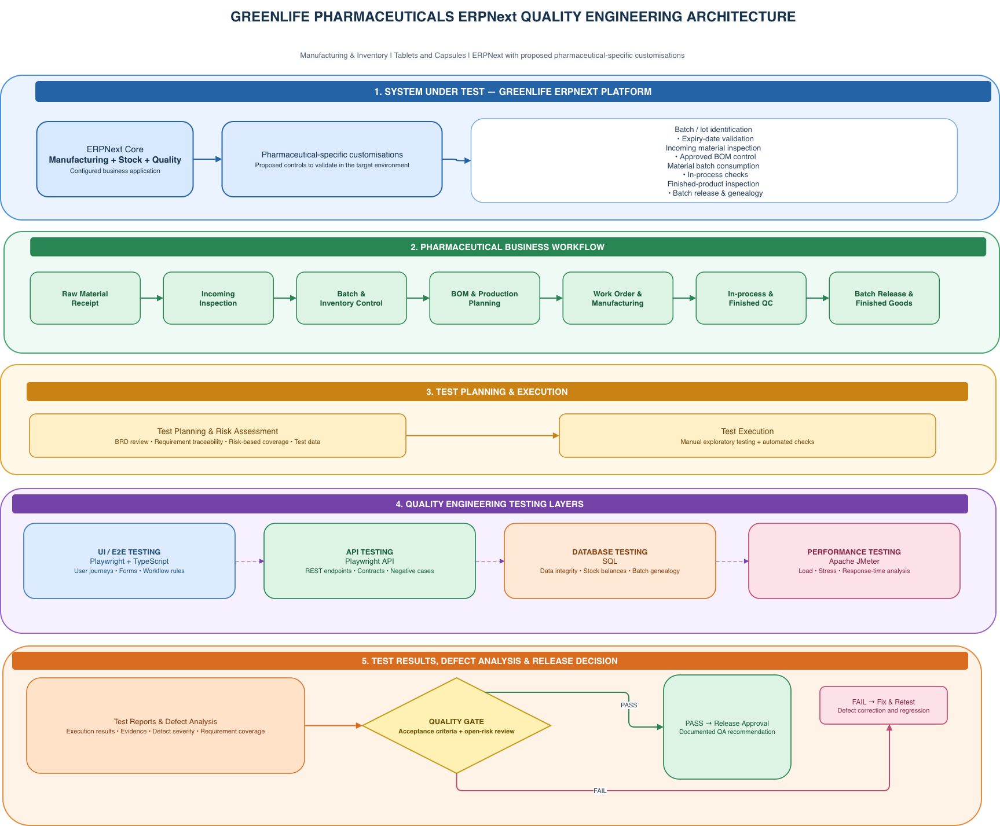

 


# Greenlife Pharmaceuticals Limited ERPNext Quality Assurance Engineering

[](https://github.com/mikekoe/ERPNext-analysis/actions/workflows/playwright.yml)

A quality assurance engineering project that tests an ERPNext implementation configured for Greenlife Pharmaceuticals Limited, a pharmaceutical manufacturing and inventory case study set in Nigeria. It checks whether ERPNext supports procurement, batch-controlled warehouse stock, manufacturing and stock traceability correctly, using manual exploratory testing, Playwright UI automation and Postman API tests.

The system under test is a local development instance. This is a testing portfolio project, not an official Greenlife Pharmaceuticals production system and not an ERPNext tutorial.

|                        |                                                                      |
| ---------------------- | -------------------------------------------------------------------- |
| Working branch         | `feature/greenlife-pharma-QA`                                        |
| System under test      | ERPNext `16.55.0`, Frappe Framework `16.56.0`, Frappe Bench `5.31.1` |
| Business case          | Greenlife Pharmaceuticals Limited, Nigeria                           |
| ERPNext company record | `GreenLife Pharma`                                                   |
| Instance URL           | `http://greenlife.localhost:8000` (local only)                       |

## Quality engineering scope

Testing is organised around the following business and technical areas.

### Inventory management

- Item and item-group configuration.
- Warehouse configuration and warehouse selection.
- Material receipts and internal stock transfers.
- Batch and serial tracking configuration.
- Stock balance and valuation verification.
- Inventory movement between source, work-in-progress and target warehouses.

### Procurement

- Supplier and purchase receipt workflows.
- Purchase receipt item, quantity, rate and warehouse validation.
- Accepted and rejected quantity/warehouse handling.
- Batch assignment for batch-controlled items.
- Purchase tax template and calculated tax verification.
- Draft, submit, cancel and delete lifecycle behaviour where applicable.

### Manufacturing

- Bill of Materials (BOM) configuration and component quantity validation.
- Work Order creation, submission and status verification.
- Material Transfer for Manufacture (MTFM).
- Manufacture Stock Entry creation and submission.
- Raw material consumption and finished-goods receipt.
- Batch and Serial Bundle linkage and stock traceability.
- Reconciliation of Work Order quantities with stock transactions and warehouse balances.

### API and data validation

- Resource API create, retrieve, update and delete operations.
- Whitelisted method calls for document lifecycle operations.
- Token-based and session-based authentication scenarios.
- Positive, negative and edge-case response validation.
- Response payload, document status and linked-record assertions.
- Cross-document checks between Work Orders, Stock Entries, Batch records, Serial and Batch Bundles and Bin balances.

### Performance and database testing

Apache JMeter and SQL/MariaDB are included in the wider quality engineering scope. Their inclusion describes the intended testing capability; performance baselines, load-test outcomes and database test coverage should be reported only where supported by recorded execution evidence.

### status

**In scope:** inventory and warehouses, purchase receipts, batch and serial tracking, Bill of Materials, Work Orders, Material Transfer for Manufacture, Manufacture Stock Entries, quality inspection, and the Frappe REST API behind these workflows.

**Out of scope:** ERPNext source-code testing, unrelated ERPNext modules, and any public or production deployment.

| Area                                | Status                   | Notes                                                                     |
| ----------------------------------- | ------------------------ | ------------------------------------------------------------------------- |
| Manual exploratory testing          | Executed                 | Includes quality inspection; evidence in `Manual-Exploratory-evidence/`   |
| UI automation: authentication       | Executed                 | Playwright login setup and login tests                                    |
| UI automation: inventory            | Executed                 | Item groups, purchase receipt, stock management, stock reports, warehouse |
| UI automation: manufacturing        | Executed                 | BOM and Work Order                                                        |
| API testing (Postman)               | Executed                 | 73-request collection, not yet committed to this repository               |
| Database validation (SQL / MariaDB) | Planned                  |                                                                           |
| Performance testing (Apache JMeter) | Planned                  |                                                                           |
| CI (GitHub Actions)                 | Implemented, not yet run | See [Continuous integration](#continuous-integration)                     |

**Executed:** run against the local instance. **Implemented:** in the repository but not yet run. **Planned:** not yet in the repository.

## Architecture



[Open the SVG version](./Greenlife-ERPNext-Quality-Engineering-Architecture.drawio.svg)

Database validation and performance testing appear in the diagram as planned components.

## Repository structure

```text
ERPNext-analysis/
├── .github/workflows/playwright.yml
├── Manual-Exploratory-evidence/       # exploratory session screenshots
├── docs/                              # BRD, test plan, RTM, exploratory log,
│                                      # execution report, defect report
├── tests/
│   ├── auth.setup.ts
│   └── ui/
│       ├── authentication/
│       ├── inventory/
│       └── manufacturing/
├── GREENLIFE-ERPNext-QUALITY-ENGINEERING-ARCHITECTURE.drawio.png
├── Greenlife-ERPNext-Quality-Engineering-Architecture.drawio.svg
├── .env.example
├── playwright.config.ts
├── package.json
└── LICENSE
```

## Setup

**Prerequisites:** Node.js (current LTS), Setup and generate SSH on local storage, npm, and a running local ERPNext instance at `http://greenlife.localhost:8000` (see below).

### Local ERPNext instance

The tests run against ERPNext installed locally with Frappe Bench. Install the prerequisites listed in the [Frappe installation guide](https://docs.frappe.io/framework-git/getting-started/installation) (including Python, Node.js, MariaDB and Redis), then:

```bash
pipx install frappe-bench
bench init --frappe-branch version-16 frappe-bench
cd frappe-bench
bench new-site greenlife.localhost       # prompts for the MariaDB root and Administrator passwords
bench get-app erpnext --branch version-16
bench --site greenlife.localhost install-app erpnext
bench --site greenlife.localhost add-to-hosts   # only if greenlife.localhost does not resolve
bench use greenlife.localhost
bench start                              # serves the site on port 8000
```

Then open `http://greenlife.localhost:8000`, log in as `Administrator` with the password set during `new-site`, complete the setup wizard and create the `GreenLife Pharma` company record. Confirm the installed versions with `bench version`.

For the tests:

- Create a test user for UI login (`ERP_USERNAME`, `ERP_PASSWORD`) and generate an API key and secret for it from the user's settings in ERPNext (`ERPNEXT_API_KEY`, `ERPNEXT_API_SECRET`).
- Create the data the tests rely on (items, warehouses, suppliers, BOMs, batches). This repository does not seed it.

### Get Started

```bash
git clone git@github.com:mikekoe/ERPNext-analysis.git  # using SSH
cd ERPNext-analysis
git checkout feature/greenlife-pharma-QA
npm ci
npx playwright install
cp .env.example .env     # then fill in the values; never commit .env
```

| Variable                                | Purpose                                  |
| --------------------------------------- | ---------------------------------------- |
| `BASE_URL`, `API_BASE_URL`              | ERPNext UI and API addresses             |
| `ERP_USERNAME`, `ERP_PASSWORD`          | Test user for UI login                   |
| `ERPNEXT_API_KEY`, `ERPNEXT_API_SECRET` | API credentials for token authentication |

## Running the tests

### Playwright UI tests

The suite has three test areas: authentication, inventory and manufacturing. All three have been run against the local instance.

```bash
npx playwright test                           # all tests
npx playwright test tests/ui/authentication   # authentication
npx playwright test tests/ui/inventory        # inventory
npx playwright test tests/ui/manufacturing    # manufacturing
npx playwright show-report                    # open the HTML report
```

Login is handled by `tests/auth.setup.ts`. The saved session state (`.auth/user.json`) is generated locally and must not be committed.

Code quality checks:

```bash
npm run lint            # lint
npm run typecheck       # TypeScript type check
npm run format:check    # check formatting
npm run format          # apply formatting
```

**Exploring the ERPNext UI with codegen.** Playwright's code generator was used to inspect the ERPNext interface and identify locators for the tests. Loading the saved session opens ERPNext already logged in:

```bash
npx playwright codegen --load-storage=.auth/user.json http://greenlife.localhost:8000/
```

Codegen output is a starting point. Locators and assertions are reviewed and moved into the test files before use. Run the authentication setup first so that `.auth/user.json` exists, and treat that file as a credential.

### API tests (Postman)

| Item           | Detail                                                                                                             |
| -------------- | ------------------------------------------------------------------------------------------------------------------ |
| Collection     | `Greenlife ERPNext API analysis` (Postman Collection v2.1 JSON)                                                    |
| Location       | Local file, not yet committed to this repository                                                                   |
| Requests       | 73 (34 `GET`, 31 `POST`, 4 `PUT`, 4 `DELETE`)                                                                      |
| Scripts        | 62 requests with post-response test scripts, 8 with pre-request scripts                                            |
| Authentication | API token (`Authorization: token api_key:api_secret`) and session login (`sid` cookie), used in separate scenarios |
| Base URL       | `{{base_url}}` variable (`http://greenlife.localhost:8000`)                                                        |
| Credentials    | Referenced as variables only; none are stored in the collection                                                    |

| Folder                                          | Requests | Coverage                                                                                                                                                         |
| ----------------------------------------------- | -------: | ---------------------------------------------------------------------------------------------------------------------------------------------------------------- |
| Authentication and Onboarding                   |        5 | API token and username/password login, company check, authenticated user check, logout                                                                           |
| Inventory                                       |       18 | Items, warehouses, supplier, single and multiple batches, Material Transfer create, update, submit, cancel, delete and amend                                     |
| Procurement                                     |        7 | Purchase Receipt retrieve, create, update, submit and delete                                                                                                     |
| Manufacturing module                            |       30 | BOM and Work Order lifecycle, Material Transfer for Manufacture, Manufacture Stock Entry, Work Order completion check                                            |
| Negative / Error-handling and Edge-Case testing |       13 | Invalid login and credentials, insufficient permissions, unauthenticated access, invalid BOM and item codes, empty Work Order, insufficient stock, missing items |

| Operation                                         | Route                                                                                   |
| ------------------------------------------------- | --------------------------------------------------------------------------------------- |
| Create, list, retrieve, update, delete a document | `/api/resource/{DocType}[/{name}]` with `POST`, `GET`, `PUT`, `DELETE`                  |
| Insert one or several documents                   | `POST /api/method/frappe.client.insert`, `frappe.client.insert_many`                    |
| Submit or cancel a document                       | `POST /api/method/frappe.client.submit`, `frappe.client.cancel`                         |
| Generate a stock entry from a Work Order          | `POST /api/method/erpnext.manufacturing.doctype.work_order.work_order.make_stock_entry` |
| Log in; check the current user                    | `POST /api/method/login`; `GET /api/method/frappe.auth.get_logged_user`                 |

**Running the collection**

1. Import the collection and create a Postman environment with `base_url` set to the instance URL.
2. Store `api_key`, `api_secret`, `login_username` and `login_password` as Postman variables. Never export or commit populated values.
3. Set the test-data variables the collection references (company, supplier, tax template, warehouses, items, batch numbers). Document names are filled in during the run.
4. Run one folder at a time, in order. Many requests create, submit, cancel or delete records, so do not re-run the full collection against the same data.

ERPNext document state is `docstatus` (`0` draft, `1` submitted, `2` cancelled). The scripts assert `docstatus`, business status and stock effects, not only the HTTP status, and submit the freshly retrieved document to avoid timestamp-mismatch errors.

## Continuous integration

`.github/workflows/playwright.yml` runs on pushes and pull requests to `main` and `master`. It installs dependencies and Playwright browsers, runs lint, the format check and the Playwright suite, and uploads the report as an artefact.

The workflow has not yet run, so the badge above shows no status until the first run on `main`. The UI tests need a reachable ERPNext instance and the credentials from `.env.example`, which a GitHub-hosted runner does not have. Until an instance and repository secrets are provided, CI can validate linting and formatting but not the ERPNext-dependent tests.

## Verified manufacturing workflow

One Work Order was taken through the full manufacturing flow with the API collection: BOM `BOM-TAB-001-005` for `TAB-001`, Work Order `MFG-WO-2026-00153` (quantity 2), Material Transfer for Manufacture `MAT-STE-2026-00091` and Manufacture Stock Entry `MAT-STE-2026-00092`.

Observed results: the Work Order reached `Completed` with 2 units produced; 1 gram of `API-001` and about 1.333 roll of `PKG-003` were transferred to `Work In Progress - GP` and consumed; 2 units of `TAB-001` were received into `Finished Goods - GP`. Serial and Batch Bundles linked each consumed and produced quantity to its batch and warehouse, and total outgoing and incoming stock value matched. Bundle quantities can display at a different precision from the source transaction, so assertions should use the configured precision.

## Test Documentation and Artefacts

| Document                                                                                                                        | Purpose                                   |
| ------------------------------------------------------------------------------------------------------------------------------- | ----------------------------------------- |
| [`GREENLIFE-BRD.md`](docs/GREENLIFE-BRD.md)                                                                                     | Business context, scope and workflows     |
| [`GREENLIFE-TEST-PLAN.md`](docs/GREENLIFE-TEST-PLAN.md)                                                                         | Scope, approach, risks and strategy       |
| [`GREENLIFE-EXPLORATORY-TESTING-CHARTER-AND-SESSION-LOG.xlsx`](docs/GREENLIFE-EXPLORATORY-TESTING-CHARTER-AND-SESSION-LOG.xlsx) | Exploratory charters, notes and findings  |
| [`GREENLIFE-RTM.xlsx`](docs/GREENLIFE-RTM.xlsx)                                                                                 | Requirements traceability matrix          |
| [`TEST-EXECUTION-REPORT.md`](docs/TEST-EXECUTION-REPORT.md)                                                                     | Recorded execution results                |
| [`Defect-report.xlsx`](docs/Defect-report.xlsx)                                                                                 | Defects with steps, severity and evidence |

## Observations and limitations

**Open observations** (for investigation, not confirmed defects):

- An `API-001` Bin in the Work In Progress warehouse showed a negative `projected_qty` while `actual_qty` stayed positive. This needs checking against reservations and demand.
- Availability fields in a Work Order's required-items table (and `max_producible_qty`, which returned 0 even though manufacture completed) did not always match later Bin balances. Use a fresh Bin read to verify current stock.
- Exploratory sessions recorded behaviour around quality inspection, such as Material Issue and Manufacture entries proceeding after a rejected inspection. See the exploratory log and defect report.

**Limitations**

- Results come from one local instance and do not establish production correctness, performance or regulatory compliance.
- Database and performance testing are planned, so no coverage or results are claimed for them.
- The Postman collection is not yet in the repository.
- ERPNext-dependent tests cannot run in CI without a reachable instance.

## References

- Frappe: [Installation guide](https://docs.frappe.io/framework-git/getting-started/installation), [REST API](https://docs.frappe.io/framework/user/en/api/rest), [Integration: REST API](https://docs.frappe.io/framework/user/en/guides/integration/rest_api), [Token-based authentication](https://docs.frappe.io/framework/user/en/guides/integration/rest_api/token_based_authentication), [Simple authentication](https://docs.frappe.io/framework/user/en/guides/integration/rest_api/simple_authentication)
- ERPNext: [Bill of Materials](https://docs.frappe.io/erpnext/bill-of-materials), [Work Order](https://docs.frappe.io/erpnext/work-order), [Stock Entry](https://docs.frappe.io/erpnext/stock-entry), [Serial and Batch](https://docs.frappe.io/erpnext/serial-and-batch), [Batch](https://docs.frappe.io/erpnext/batch), [Serial and Batch Bundle](https://docs.frappe.io/erpnext/serial-and-batch-bundle), [Stock Reservation for Work Order](https://docs.frappe.io/erpnext/stock-reservation-for-work-order)
- Tooling: [Playwright](https://playwright.dev/docs/intro), [Postman](https://learning.postman.com/docs/), [GitHub Actions](https://docs.github.com/en/actions), [Apache JMeter](https://jmeter.apache.org/usermanual/index.html) (planned)

## License

Released under the [MIT License](LICENSE).

## Author

Michael Adeyeye, QA Engineer, Lagos, Nigeria
