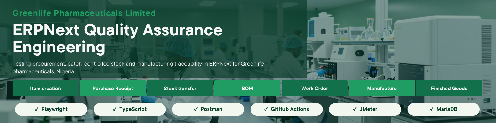
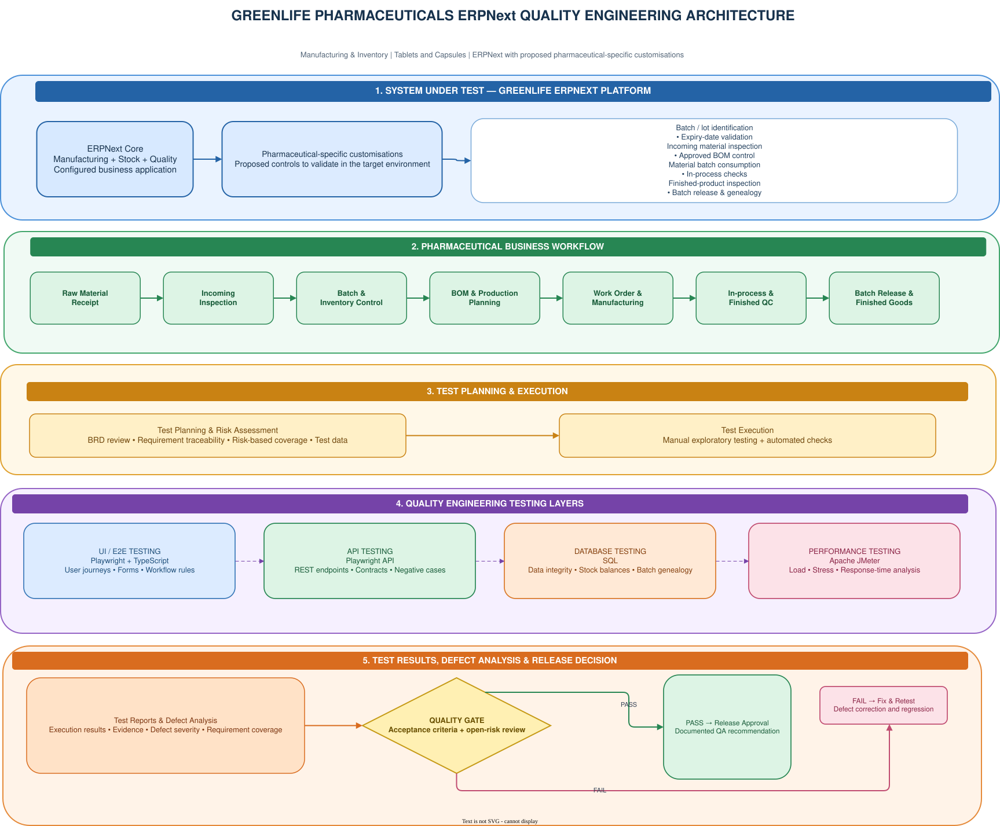
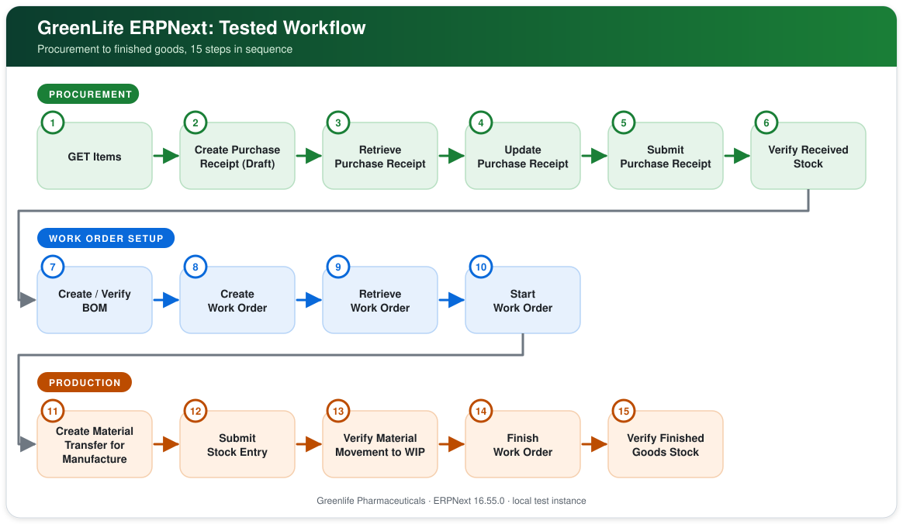

# Greenlife Pharmaceuticals Limited ERPNext Test Suite

<h2 align="center">Tech Stack & Tools</h2>

<p align="center">
  <strong>Languages</strong><br/>
  
  
  
</p>

<p align="center">
  <strong>Test Automation & QA</strong><br/>
  
  
  
</p>

<p align="center">
  <strong>ERP Platform & Database</strong><br/>
  
  
  
</p>

<p align="center">
  <strong>Runtime & Package Management</strong><br/>
  
  
</p>

<p align="center">
  <strong>Code Quality & Formatting</strong><br/>
  
  
</p>

<p align="center">
  <strong>Development & Version Control</strong><br/>
  
  
  
  
</p>

<p align="center">
  
</p>

---


<!-- [](https://github.com/mikekoe/ERPNext-analysis/actions/workflows/playwright.yml)-->

A end-to-end manual and automation project that tests an ERPNext implementation configured for Greenlife Pharmaceuticals Limited, a pharmaceutical manufacturing and inventory case study set in Nigeria. It checks whether ERPNext supports procurement, batch-controlled warehouse stock, manufacturing and stock traceability correctly, using manual exploratory testing, Playwright UI automation, maria-db and Postman API tests.

The system under test is a local development instance. This is a solo testing project, not an official Greenlife Pharmaceuticals production system and not an ERPNext tutorial.

|                        |                                                |
| ---------------------- | ---------------------------------------------- |
| System Under Test      | ERPNext `16.55.0`                              |
| Business case          | Greenlife Pharmaceuticals Limited, Nigeria     |
| ERPNext company record | `GreenLife Pharma`                             |
| Instance URL           | `http://greenlife.localhost:8000` (local only) |

---

## Project scope

Testing is organised around the following business and technical areas:

### Inventory management

- Item and item-group configuration.
- Warehouse configuration and warehouse selection.
- Material receipts and internal stock transfers.
- Batch and serial tracking configuration.
- Stock balance and valuation verification.
- Inventory movement between source, work-in-progress and target warehouses.

### Procurement

- Supplier and purchase receipt workflows.
- Purchase receipt item, quantity, rate and warehouse validation.
- Accepted and rejected quantity/warehouse handling.
- Batch assignment for batch-controlled items.
- Purchase tax template and calculated tax verification.
- Draft, submit, cancel and delete lifecycle.

### Manufacturing

- Bill of Materials (BOM) configuration and component quantity validation.
- Work Order creation, submission and status verification.
- Material Transfer for Manufacture (MTFM).
- Manufacture Stock Entry creation and submission.
- Raw material consumption and finished-goods receipt.
- Batch and Serial Bundle linkage and stock traceability.
- Reconciliation of Work Order quantities with stock transactions and warehouse balances.

### API and data validation

- Resource API CRUD (create, retrieve, update and delete operations).
- Positive, negative and edge-case response validation.
- Response payload, document status and linked-record assertions.
- Cross-document checks between Work Orders, Stock Entries, Batch records, Serial and Batch Bundles and Bin balances.

### Performance and database testing

Apache JMeter and MariaDB are part of the testing scope. They perform performance baselines, load-test outcomes and database test coverage.

### Scope breakdown

**In scope:** inventory and warehouses, purchase receipts, batch and serial tracking, Bill of Materials, Work Orders, Material Transfer for Manufacture, Manufacture Stock Entries, quality inspection, and the Frappe REST API behind these workflows.
Screenshots captured during the tests are available in the **assets/screenshots/** folder.

**Out of scope:** ERPNext source-code testing and unrelated ERPNext modules

| Area                                | Status   | Notes                                                                     |
| ----------------------------------- | -------- | ------------------------------------------------------------------------- |
| Manual exploratory testing          | Executed | Includes quality inspection; evidence in `Manual-Exploratory-evidence/`   |
| UI automation: authentication       | Executed | Playwright login setup and login tests                                    |
| UI automation: inventory            | Executed | Item groups, purchase receipt, stock management, stock reports, warehouse |
| UI automation: manufacturing        | Executed | BOM and Work Order                                                        |
| API testing (Postman)               | Executed | 73-request collection                                                     |
| Database validation (SQL / MariaDB) | Executed |                                                                           |
| Performance testing (Apache JMeter) | Executed |                                                                           |

**Executed:** run against the local instance. **Implemented:** in the repository but not yet run. **Planned:** not yet in the repository.

---

## Architecture



[Open the PNG version](./GREENLIFE-ERPNext-QUALITY-ENGINEERING-ARCHITECTURE.drawio.png)

Database validation and performance testing appear in the diagram as planned components.

### Repository structure

```text
ERPNext-analysis/
├── .github/workflows/playwright.yml      
├── docs/                              # BRD, test plan, RTM, exploratory log,
│                                      # execution report, defect report, test summary
├── tests/
│   ├── auth.setup.ts
│   └── ui
│   └── api/postman
│   └── performance/jmeter
│   
├── GREENLIFE-ERPNext-QUALITY-ENGINEERING-ARCHITECTURE.drawio.png
├── Greenlife-ERPNext-Quality-Engineering-Architecture.drawio.svg
├── .env.example
├── playwright.config.ts
├── README.md
├── eslint.config.mjs
├── playwright.config.ts
├── package.json
├── package-lock.json
├── tsconfig.json
├── .gitignore
├── assets
├── playwright-reports
└── LICENSE
```

### Business Workflow

<p align="center">
  
</p>

---

## Setup

**Prerequisites:** Node.js (current LTS), Setup and generate SSH on local storage, npm, and a running local ERPNext instance at `http://greenlife.localhost:8000`.

#### Local ERPNext instance

The tests run against ERPNext installed locally with Frappe Bench. Install and configure the prerequisites listed in the [Frappe installation guide](https://docs.frappe.io/framework-git/getting-started/installation) (including Docker, Python, Node.js, MariaDB and Redis), then do these on your terminal:

```bash
cd <Your-installation-folder>

git clone https://github.com/frappe/frappe_docker.git

cd frappe_docker

Configure docker development environment (https://github.com/frappe/frappe_docker)

docker ps -a

docker exec -it frappe_docker_devcontainer-frappe-1 bash

Navigate to Bench environment and initialise a bench directory

cd /workspace/development/

bench init greenlife-bench

cd greenlife-bench

bench get-app erpnext --branch version-16 (or latest branch)

bench new-site greenlife.localhost       # prompts for the MariaDB root and Administrator passwords

bench get-app erpnext --branch version-16

bench --site greenlife.localhost install-app erpnext

bench --site greenlife.localhost add-to-hosts   # only if greenlife.localhost does not resolve

bench use greenlife.localhost

bench start                              # the site goes live on port 8000
```

Then open `http://greenlife.localhost:8000`, log in as `Administrator` with the password set during `new-site`, complete the setup wizard and create the `GreenLife Pharma` company record. Confirm the installed versions with `bench version`.

For the tests:

- Create a test user for UI login (`ERP_USERNAME`, `ERP_PASSWORD`) and generate an API key and secret for it from the user's settings in ERPNext (`ERPNEXT_API_KEY`, `ERPNEXT_API_SECRET`).
- Create the needed data (items, warehouses, suppliers, BOMs, batches).

### Local Environment Setup

```bash
git clone git@github.com:mikekoe/ERPNext-analysis.git  # using SSH

cd ERPNext-analysis

git checkout feature/greenlife-pharma-QA

npm ci

npx playwright install

cp .env.example .env     # then fill in the values; never commit .env
```

| Variable                                | Purpose                                  |
| --------------------------------------- | ---------------------------------------- |
| `BASE_URL`, `API_BASE_URL`              | ERPNext UI and API addresses             |
| `ERP_USERNAME`, `ERP_PASSWORD`          | Test user for UI login                   |
| `ERPNEXT_API_KEY`, `ERPNEXT_API_SECRET` | API credentials for token authentication |

---

## Running the tests

## Playwright UI Automation tests

**Pre-requisites**: Refer to Playwright documentation for installation requirements and steps

The suite has three test areas: authentication, inventory and manufacturing. All three have been run against the local instance.

**Inspecting the ERPNext UI with codegen.** Playwright's code generator was used to inspect the ERPNext local site and identify locators, assert for text and visibility. Loading the saved session opens ERPNext already logged in:

```bash
npx playwright codegen --load-storage=.auth/user.json http://greenlife.localhost:8000/
```

```bash
npx playwright test                           # all tests

npx playwright test tests/ui/authentication   # authentication

npx playwright test tests/ui/inventory        # inventory

npx playwright test tests/ui/manufacturing    # manufacturing

npx playwright show-report                    # open the HTML report
```

`tests/auth.setup.ts`: Performs the login and saves the authentication state
`.auth/user.json`: retrieves the state from the above file on each Playwright run (for faster login)

### Code quality checks:

These checks are run before pushing the code to Github.

```bash
npm run lint            # lint

npm run typecheck       # TypeScript type check

npm run format:check    # check formatting

npm run format          # apply formatting
```

### 🎭 Playwright Test Results


| Test Module             |  Tests |                                                                                      Passed | Failed |
| ----------------------- | -----: | ------------------------------------------------------------------------------------------: | -----: |
| 🔐 Authentication       |      7 |   |      0 |
| 📦 Inventory Management |     11 |  |      0 |
| 🏭 Manufacturing        |      2 |   |      0 |
| **Total**               | **20** |                                                                                    **20 ✓** |  **0** |


---

### API tests (Postman)

| Item           | Detail                                                                  |
| -------------- | ----------------------------------------------------------------------- |
| Collection     | `Greenlife ERPNext API analysis` (Postman Collection v2.1 JSON)         |
| Requests       | 73 (34 `GET`, 31 `POST`, 4 `PUT`, 4 `DELETE`)                           |
| Scripts        | 62 requests with post-response test scripts, 8 with pre-request scripts |
| Authentication | API token (`Authorization: token api_key:api_secret`)                   |
| Base URL       | `{{base_url}}` variable (`http://greenlife.localhost:8000`)             |
| Credentials    | Referenced as variables only; none are stored in the collection         |

| Folder                                          | Requests | Coverage                                                                                                                                                         |
| ----------------------------------------------- | -------: | ---------------------------------------------------------------------------------------------------------------------------------------------------------------- |
| Authentication and Onboarding                   |        5 | API token and username/password login, company check, authenticated user check, logout                                                                           |
| Inventory                                       |       18 | Items, warehouses, supplier, single and multiple batches, Material Transfer create, update, submit, cancel, delete and amend                                     |
| Procurement                                     |        7 | Purchase Receipt retrieve, create, update, submit and delete                                                                                                     |
| Manufacturing module                            |       30 | BOM and Work Order lifecycle, Material Transfer for Manufacture, Manufacture Stock Entry, Work Order completion check                                            |
| Negative / Error-handling and Edge-Case testing |       13 | Invalid login and credentials, insufficient permissions, unauthenticated access, invalid BOM and item codes, empty Work Order, insufficient stock, missing items |

| Operation                                         | Method                                                                                  |
| ------------------------------------------------- | --------------------------------------------------------------------------------------- |
| Create, list, retrieve, update, delete a document | `/api/resource/{DocType}[/{name}]` with `POST`, `GET`, `PUT`, `DELETE`                  |
| Insert one or several documents                   | `POST /api/method/frappe.client.insert`, `frappe.client.insert_many`                    |
| Submit or cancel a document                       | `POST /api/method/frappe.client.submit`, `frappe.client.cancel`                         |
| Generate a stock entry from a Work Order          | `POST /api/method/erpnext.manufacturing.doctype.work_order.work_order.make_stock_entry` |
| Log in and check the current user                 | `POST /api/method/login`; `GET /api/method/frappe.auth.get_logged_user`                 |

### HTTP Status Code Reference

| Status Code                                               | Meaning                        | Usage in Testing                                                      |
| --------------------------------------------------------- | ------------------------------ | --------------------------------------------------------------------- |
| `200, 201, 202 OK`                                        | Request completed successfully | Retrieving records, updating documents, and successful API operations |
| `401, 403, 417 Bad Request, Unauthorized, Request failed` | Authentication failed          | Invalid or malformed request                                          | Missing mandatory fields or invalid request data |
| `500 Internal Server Error`                               | Unexpected server-side error   | Unexpected application or server failures requiring investigation     |

**Note:** ERPNext validation errors may return different HTTP status codes depending on the endpoint and error condition. Always validate the response body and expected business outcome alongside the status code.

**Running the collection**

1. Create the collection and a Postman environment with `base_url` set to the instance URL.
2. Store `api_key`, `api_secret`, `login_username` and `login_password` as Postman environment variables. The remaining variables are created and stored as the tests are run.
3. Set the initial test-data variables (company, supplier, tax template, warehouses, items, batch numbers).
4. Positive tests validate the complete business process. So do not re-run the full collection against the same data. It is preferrable to execute the workflow independently, in the documented sequence, rather than running the entire positive test suite as a collection. Each operation may create, modify, submit, cancel, amend or otherwise change ERPNext records. When a Positive test fails, its might not be a defect, check the document's current state, required dependencies, generated environment variables, and execution order before classifying the failure.
5. Negative test / Error-handling test suite can be executed using the Collection Runner. These tests validate ERPNext's handling of invalid, incomplete, or unsupported requests without depending on the successful completion of the entire procurement-to-manufacturing workflow.

ERPNext document state is `docstatus` (`0` draft, `1` submitted, `2` cancelled). The scripts assert `docstatus`, business status and stock effects, not only the HTTP status. This also determines how the tests are run

**Refer to the [Business Workflow] above**

### Postman Execution Results


### Positive API Testing

<progress value="57" max="60"></progress> 95% (57/60 passed)

### Negative API Testing

<progress value="12" max="13"></progress> 92.3% (12/13 passed)

### Overall Execution

<progress value="69" max="73"></progress> 94.5% (69/73 passed)

---

## JMeter

### Installation

**Pre-requisites**: These includes **java**, **Jmeter** Refer to [Apache JMeter](https://jmeter.apache.org/usermanual/index.html)

1. Enter `jmeter` in your terminal
2. cd ~/ERPNext-analysis
3. Configure HTTP Request Defaults, HTTP Header Manager, User Defined Variables, HTTP methods

```
HTTP Configuration
Protocol: HTTP
Server: greenlife.localhost
Port: 8000
Authorization: token ${API_KEY}:${API_SECRET}
Accept: application/json
Content-Type: application/json
```

### Performance Test Scenarios

Five performance scenarios were documented: baseline, load, three stress configurations, and endurance.

<h3>
  
  JMeter Performance Test Report
</h3>

<p align="center">
  
  
  
  
</p>

### 📊 Execution Summary

| Test Metric                    |          Result |
| :----------------------------- | --------------: |
| Performance scenarios          |               5 |
| Stress configurations          |               3 |
| API endpoints measured         |               4 |
| Highest stress-test throughput | **55.09 req/s** |
| Highest recorded throughput    | **64.26 req/s** |
| Longest test duration          |  **30 minutes** |
| Stress-test error rate         |          **0%** |
| Endurance-test error rate      |       **0.02%** |

> **Test environment:** GreenLife Pharma ERPNext instance running locally at `http://greenlife.localhost:8000`.

### 🧪 Testing Objectives

The testing objectives were to:

- Establish baseline API response times.
- Evaluate API behaviour under increasing user loads.
- Measure throughput and response-time changes.
- Identify errors under sustained workloads.

### JMeter test plan configuration

The test plan uses the following components:

| Component              | Purpose                                        |
| ---------------------- | ---------------------------------------------- |
| Thread Group           | Defines virtual users, ramp-up and iterations  |
| HTTP Request Defaults  | Configures the target server and port          |
| HTTP Header Manager    | Defines request headers and API authentication |
| User Defined Variables | Stores reusable test configuration             |
| CSV Data Set Config    | Supplies external test data where required     |
| HTTP Request           | Executes REST API requests                     |
| Response Assertions    | Validates HTTP responses                       |
| JSON Extractor         | Extracts values from API responses             |
| JMESPath Assertions    | Validates JSON response content                |

### 🔄 API Workflow Coverage

The performance testing work was designed around the ERPNext API workflows used in the GreenLife Pharma QA project.

| Method          | Workflow                                   | QA objective                        |
| --------------- | ------------------------------------------ | ----------------------------------- |
| GET             | Retrieve inventory and document records    | Verify retrieval and response data  |
| POST            | Create records                             | Verify successful resource creation |
| PUT             | Update records and submit documents        | Verify state changes                |
| DELETE / Cancel | Delete or cancel documents where supported | Verify document lifecycle behaviour |

### API endpoints measured

| Sampler        | Endpoint                   |
| -------------- | -------------------------- |
| GET items      | `/api/resource/Item`       |
| GET Warehouses | `/api/resource/Warehouse`  |
| GET Inventory  | `/api/resource/Bin`        |
| GET Work Order | `/api/resource/Work Order` |

### ⚡ Performance Test Scenarios

Five performance scenarios were documented: baseline, load, three stress configurations, and endurance.

**Endpoint performance**

| Endpoint       | Samples | Avg (ms) | P95 (ms) | P99 (ms) | Errors |
| -------------- | ------: | -------: | -------: | -------: | -----: |
| GET Inventory  |  29,065 |    456.8 |      696 |      940 |      6 |
| GET Warehouses |  29,076 |    452.9 |      682 |      914 |      4 |
| GET Work Order |  29,054 |    467.6 |      682 |      869 |      6 |
| GET items      |  29,081 |    453.3 |      684 |      928 |      6 |

**Response codes**

| HTTP status | Description           |   Count |
| ----------- | --------------------- | ------: |
| 200         | OK                    | 115,654 |
| 401         | Unauthorized          |      12 |
| 500         | Internal Server Error |      10 |

**Failure observations**

The 22 failed requests occurred around minutes 17–21:

- 12 authentication failures (401).
- 10 internal server errors (500).

### Overall results

| Metric             | Baseline |   Load | Stress 10 | Stress 20 | Stress 30 | Endurance |
| ------------------ | -------: | -----: | --------: | --------: | --------: | --------: |
| Samples            |        4 |    100 |       200 |       400 |       600 |   115,676 |
| Average (ms)       |       90 |  58.83 |     55.64 |      61.0 |      75.6 |     459.2 |
| Median (ms)        |      90* |     56 |        55 |        60 |        75 |       438 |
| P95 (ms)           |      90* |  70.35 |        63 |        71 |        92 |       686 |
| P99 (ms)           |      90* | 114.06 |     74.05 |        82 |       111 |       919 |
| Throughput (req/s) |    11.08 |  10.87 |     19.71 |     37.76 |     55.09 |     64.26 |
| Error rate         |       0% |     0% |        0% |        0% |        0% |     0.02% |

\*Baseline percentile figures are not statistically meaningful because there was only one sample per endpoint.

### ▶️ Executing Tests and Generating Reports

Run JMeter in non-GUI mode using a fresh result file and report directory for each execution.

```bash

jmeter -n \
  -t GreenLife_ERPNext_Performance_Test.jmx \
  -l results/stress/stress_test.jtl \
  -e \
  -o reports/stress_report
```

Generate an HTML dashboard from an existing JTL file:

```bash
jmeter -g results/stress/stress_test.jtl \
  -o reports/stress_report
```

Open the generated report:

```bash
open reports/stress_report/index.html
```

Repeat with the appropriate test plan and result file for each scenario. Ensure the intended Thread Group is enabled and the output directory is empty before generating a new dashboard.

### 📑 Report and Evidence Files

1. `.jmx`: This contains the JMeter test plan and configuration (Check **tests/ui/performance/jmeter**)

2. `.jtl` Raw performance test results (Check **tests/ui/performance/jmeter/results**)

3. HTML Dashboard (Check the **tests/ui/performance/jmeter** for index file of each test)

4. CSV files of saved test results run in Jmeter (Check **tests/ui/performance/jmeter/data**)

5. Screenshots (Check **assets/screenshots/jmeter**)

### 🏁 Conclusion

Apache JMeter was used to assess the GreenLife Pharma ERPNext API through baseline, load, stress and endurance testing.

The three stress scenarios recorded zero errors, with throughput increasing as the configured thread count increased. The endurance run processed more than 115,000 samples in approximately 30 minutes, with a 0.02% error rate and higher average response times.

---


## Database testing

<h3>
  
    Maria-Db
</h3>

*Read-only database validation of purchasing, inventory, batch traceability, manufacturing and cancellation workflows.*

> **Safety:** All database validation was read-only. The test session used `SELECT`, `SHOW` and `DESCRIBE`. No direct SQL `INSERT`, `UPDATE`, `DELETE`, schema changes or other database writes were performed.

### Installation

**Pre-requisites**: ERPnext bench setup is available

1. **Open the ERPNext project in VS Code, go to the bench directory inthe existing development container**

```bash
cd /workspace/development/greenlife-bench

bench --site greenlife.localhost mariadb
```

2. **Confirm the database connection**

```text
MariaDB [_db_id]>
```

Use the SQL examples in the test sections below. Run one query at a time and compare the returned records with the assertions.

| Database table               | Purpose in the test                                           |
| ---------------------------- | ------------------------------------------------------------- |
| `tabPurchase Receipt`        | Purchase Receipt header, supplier, company, status and totals |
| `tabPurchase Receipt Item`   | Receipt item, quantity, batch and warehouse details           |
| `tabStock Entry`             | Material Transfer and Manufacture transaction headers         |
| `tabStock Entry Detail`      | Component and finished-item rows, quantities and warehouses   |
| `tabWork Order`              | Production item, BOM, planned quantity and completion status  |
| `tabStock Ledger Entry`      | Stock movements, running quantity, valuation and cancellation |
| `tabBin`                     | Current item quantity and stock valuation by warehouse        |
| `tabSerial and Batch Bundle` | ERPNext v16 serial/batch bundle header and voucher reference  |
| `tabSerial and Batch Entry`  | Batch-level item quantities and warehouse traceability        |
| `tabItem`                    | Item stock UOM and batch-tracking configuration               |
| `tabUOM`                     | Whether fractional quantities are permitted                   |
| `tabSingles`                 | System Settings value for float precision                     |

**Schema-discovery commands:**

```sql
SHOW TABLES LIKE '%Serial%Batch%';

DESCRIBE `tabStock Ledger Entry`;

DESCRIBE `tabBin`;

DESCRIBE `tabStock Entry Detail`;
```

Execution summary

<div align="center">

### Database validation results

</div>

<table>
<tr>
<td width="33%" align="center">

### 17

**Checks executed**

</td>
<td width="33%" align="center">

### 16

**Passed / explained**

</td>
<td width="33%" align="center">

### 0

**Confirmed defects**

</td>
</tr>
</table>

> DB-015 is retained as a precision observation and DB-016 explains the observed precision configuration. The summary does not claim full database coverage; it reflects the 17 selected checks executed in this test session.
> **
> **Check assets/Screenshots/Maria-db-testing for evidence**

---

## Test Documentation and Artefacts

| Document                                                                                                                        | Purpose                                   |
| ------------------------------------------------------------------------------------------------------------------------------- | ----------------------------------------- |
| [`GREENLIFE-BRD.md`](docs/GREENLIFE-BRD.md)                                                                                     | Business context, scope and workflows     |
| [`GREENLIFE-TEST-PLAN.md`](docs/GREENLIFE-TEST-PLAN.md)                                                                         | Scope, approach, risks and strategy       |
| [`GREENLIFE-EXPLORATORY-TESTING-CHARTER-AND-SESSION-LOG.xlsx`](docs/GREENLIFE-EXPLORATORY-TESTING-CHARTER-AND-SESSION-LOG.xlsx) | Exploratory charters, notes and findings  |
| [`GREENLIFE-RTM.xlsx`](docs/GREENLIFE-RTM.xlsx)                                                                                 | Requirements traceability matrix          |
| [`TEST-EXECUTION-REPORT.md`](docs/TEST-EXECUTION-REPORT.md)                                                                     | Recorded execution results                |
| [`Defect-report.xlsx`](docs/Defect-report.xlsx)                                                                                 | Defects with steps, severity and evidence |
| [`test-summary-report.md`](docs/test-summary-report.md)                                     | Overall summary of all tests performed and recommendations |


## Observations and limitations

See the exploratory log and defect report.

**Limitations**

- Results come from one local instance and do not establish real-time production results.
- ERPNext-dependent tests cannot run in CI without a reachable cloud instance.

## Future Features

The following features are still in development

1. **GitHub Actions Integration:** Implement automated CI workflows to execute Playwright tests on code pushes and pull requests.

2. **Automated ERPNext Environment Provisioning:** Configure Docker-based environment provisioning so GitHub Actions can independently set up ERPNext, Frappe, MariaDB and Redis for test execution.

3. **Cloud-Based Production Environment:** Provision of live server for testing the ERPNext platform

4. **Environment Health Checks:** Introduce automated alerts, availability checks and service monitoring.

5. **Database Testing extension:** Using INSERT, UPDATE, and DELETE statements to perform inventory, login and manaufacturing transactions in ERPNext.

## References

- Frappe: [Installation guide](https://docs.frappe.io/framework-git/getting-started/installation), [REST API](https://docs.frappe.io/framework/user/en/api/rest), [Integration: REST API](https://docs.frappe.io/framework/user/en/guides/integration/rest_api), [Token-based authentication](https://docs.frappe.io/framework/user/en/guides/integration/rest_api/token_based_authentication), [Simple authentication](https://docs.frappe.io/framework/user/en/guides/integration/rest_api/simple_authentication)
- ERPNext: [ERPNext](https://docs.frappe.io/erpnext)
- Tooling: [Playwright](https://playwright.dev/docs/intro), [Postman](https://learning.postman.com/docs/), [GitHub Actions](https://docs.github.com/en/actions), [Apache JMeter](https://jmeter.apache.org/usermanual/index.html), [Maria db](https://mariadb.com/docs)

## License

Released under the [MIT License](LICENSE).

## Author

Michael Adeyeye, QA Engineer
